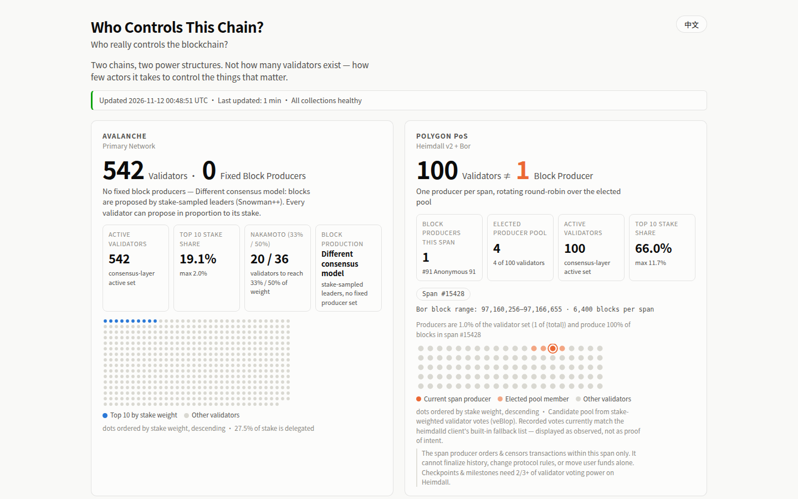

# Who Controls This Chain?

*Who really controls the blockchain?*

**Live: https://slowmoonship.github.io/who-controls-this-chain/**

An open-source, auto-updating visualization of **how power is actually distributed** on two
networks — **Avalanche Primary Network** and **Polygon PoS (Heimdall v2 + Bor)** — with every
figure traceable to a public endpoint, contract, or code reference.

Not a news site. Not a block explorer. One question, answered with live data:

> How few independent validators does it take to control the things that matter —
> consensus weight, block production, and protocol upgrades?

## The headline

**100 validators ≠ 100 block producers.** On Polygon PoS today, 100 active Heimdall validators
coexist with a Bor block-production scheme where **exactly one validator produces every block of
each 6,400-block span (~3.6 h)**, rotating round-robin over an elected pool of 4. Meanwhile the
top 10 validators hold ~66% of Heimdall voting power — just 4 validators reach the 33% weight
needed to halt finality. On Avalanche, 540+ validators hold a far flatter stake distribution
(top 10 ≈ 19%) and there is no fixed producer set at all.

Live figures always come from `data/latest.json` — never hardcoded. If a network parameter
changes on-chain (validator count, span producers, producer pool limit), the site follows.

<p align="center">
  
</p>

| Screenshot | File |
|---|---|
| Desktop 1440×900 | `docs/screenshots/desktop-1440x900.png` |
| Desktop full page | `docs/screenshots/desktop-full.png` |
| Desktop (Chinese UI) | `docs/screenshots/desktop-zh-1440x900.png` |
| Metric explanation dialog | `docs/screenshots/desktop-dialog.png` |
| Mobile 390×844 | `docs/screenshots/mobile-390x844.png` |
| Mobile full page | `docs/screenshots/mobile-full.png` |

Mobile horizontal overflow check: **0 px** (enforced in `web/scripts/shots.mjs`).

## What is shown (and what is *not* claimed)

| Shown | Deliberately not claimed |
|---|---|
| Active validator counts (live) | That validators = independent organizations (entity mapping is **Unknown** — name/address similarity is not evidence) |
| Top-10 & max stake-weight share | That a span producer controls the chain (it orders/censors within its span only; checkpoints & milestones need 2/3+ voting power) |
| Nakamoto-style concentration at **33% / 50% weight**, labeled as concentration statistics | That 33% is a universal attack threshold — CometBFT and Snowman convert weight control into capabilities differently |
| Bor span producers **as observed on-chain**, per span, with rotation history | That the current producers are the only validators that can ever produce |
| Protocol-upgrade authorities: 5-of-9 Gnosis Safe + TimelockController (getMinDelay = 0 s) for Polygon L1 contracts; compiled client releases for both networks' consensus rules | That a multisig equals arbitrary power over user funds, or that "no admin key" means "no centralization risk" |

Click any metric on the page for: what it is · how it is computed · data source · limits ·
last-verified time. Machine-readable equivalents: [`data/methodology.json`](data/methodology.json)
and [`data/sources.json`](data/sources.json).

## Architecture

```
collector/            Python 3 (stdlib only) data collector
  main.py             orchestrator: collect → validate → latest.json + history
  avalanche.py        platform.getCurrentValidators / getHeight (P-Chain RPC)
  polygon.py          Heimdall v2 REST (validators-set, spans, params, producer-votes) + Bor RPC
  authority.py        Ethereum mainnet reads: proxy slots, Safe, TimelockController roles
  metrics.py          top-share + concentration-count math (pure, tested)
  validate.py         anomaly rules (never overwrite good data with a suspected outage)
  tests/              pytest suite (metrics, validation, parsers)
web/                  Vite + TypeScript static site (no framework, no chart library)
data/
  latest.json         last VALID snapshot (per-network timestamps; failures carry forward)
  history/            one snapshot per collection attempt + index.json for trend charts
  sources.json        evidence registry (endpoints, contracts, code refs)
  methodology.json    metric definitions, formulas, caveats
.github/workflows/
  collect-and-deploy.yml   6-hourly collect → commit data → build & deploy GitHub Pages
docs/
  research-notes.md   verification log (2026-11-12 API/on-chain/source-code findings)
  screenshots/        acceptance screenshots
```

No database. No backend. No server to maintain. The site loads JSON at runtime.

## Data pipeline

* **Every 6 hours** (GitHub Actions cron + `workflow_dispatch`; GitHub does not guarantee exact
  timing) the collector fetches live data, computes metrics, and appends a history snapshot.
* **Failure policy**: a failed collection never overwrites `latest.json`; the page shows the data
  age and the error. Sudden >50% moves in validator count / total weight are recorded as
  suspected anomalies in history and are **not** promoted to official stats.
* **Reproducibility**: every snapshot stores the sorted weight vector it was computed from,
  chain heights, and the endpoint list, so all shares/concentration counts can be recomputed.
* **Cross-checks**: Bor's `bor_getCurrentValidators` is compared against the Heimdall span's
  selected producers each run; Polygon L1 upgrade authorities are re-read on-chain each run.

### Notable verified findings (2026-11-12, see `docs/research-notes.md`)

* Heimdall v2 **veBlop** ("validator-elected block producer"): validators cast stake-weighted
  positional votes for producers; the top candidates (pool limit **4** since the
  `SetProducerDowntime` hardfork) rotate **one producer per span**. `producer_count=50` in
  `/bor/params` is the legacy selection parameter and is *not* the number of live producers.
* If the vote map is empty, `heimdalld` falls back to a **client-compiled list** of producer IDs
  (`DefaultMainnetProducers = "91,92,93,94"`, `helper/config.go`) — displayed as such, not as
  proof of validator intent.
* Polygon L1: `StakeManagerProxy`/`RootChainProxy` are `UpgradableProxy`es
  (`keccak256("matic.network.proxy.implementation/owner")` slots, not EIP-1967) owned by a
  **TimelockController** whose proposer+executor is a **Gnosis Safe 5-of-9**, with
  **`getMinDelay() = 0`** seconds — re-verified every collection run.
* Avalanche Primary Network upgrades activate at **timestamps compiled into avalanchego**
  (`upgrade/upgrade.go`: Apricot…Durango…Granite…Helicon) — no on-chain admin key; control
  concentrates in client development + validator adoption.

## Local development

```bash
# tests (pip install pytest — or vendor wheels into vendor/ on restricted machines)
python3 -m pytest collector/tests -q

# collect a fresh snapshot
python3 -m collector.main --data-dir data

# site
cd web
npm install
npm run dev      # http://localhost:5173 with data/ synced into public/data
npm run build    # type-check + production build into web/dist
```

Acceptance screenshots (requires the Playwright chromium, `npx playwright install chromium`):

```bash
python3 -m http.server 8791 --directory web/dist &
node web/scripts/shots.mjs http://127.0.0.1:8791/
```

## Deploy (GitHub Pages)

1. Create a public GitHub repository and push this project to `main`.
2. Repository **Settings → Pages → Build and deployment → Source: GitHub Actions**.
3. Push (or run the `Collect data and deploy` workflow manually). The workflow:
   * runs the pytest suite, collects live data, commits `data/` (6-hourly), and
   * builds `web/` and deploys it to Pages in the **same workflow**, so data-only commits always
     re-deploy the page (no "data updated but site stale" gap).
4. Scheduled runs need the workflow to exist on the default branch; first run may be delayed by
   GitHub's scheduler.

The site uses a relative base (`vite base: './'`) so it works at
`https://<user>.github.io/<repo>/` without configuration.

## Honesty rules baked into the code

1. Validators ≠ organizations. Entity-level concentration is reported as **Unknown**; operator
   declared names (Polygon staking API) are display-only and never used to merge entities.
2. A Bor span producer ≠ chain owner; Bor block production ≠ Heimdall consensus power;
   Heimdall checkpoints/milestones require 2/3+ voting power.
3. Contract upgrade authority ≠ power over user wallets. Multisig owners are addresses;
   real-world identities are not verified.
4. Avalanche Primary Network ≠ independent Avalanche L1s; Polygon PoS ≠ Polygon zkEVM/Agglayer.
5. 33%/50% figures are labeled weight-concentration statistics, not asserted attack thresholds.
6. Collection failures and anomalies leave the last valid data untouched and visibly aged.

## License

MIT.
